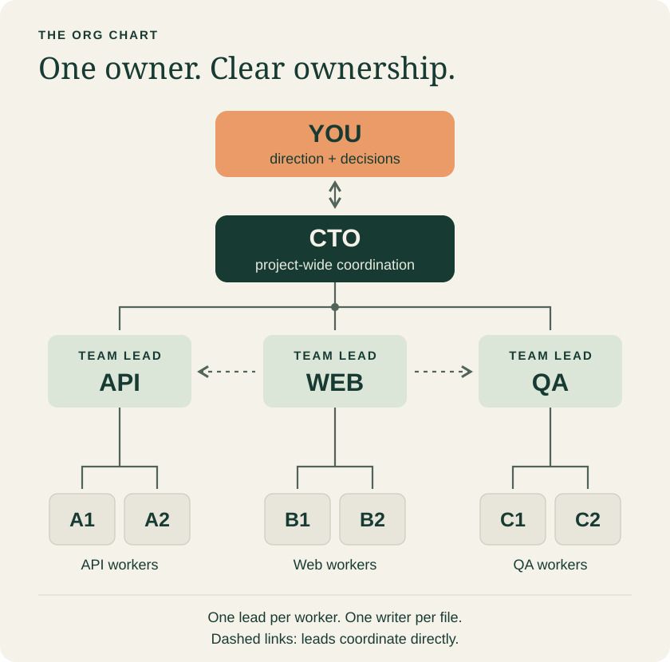
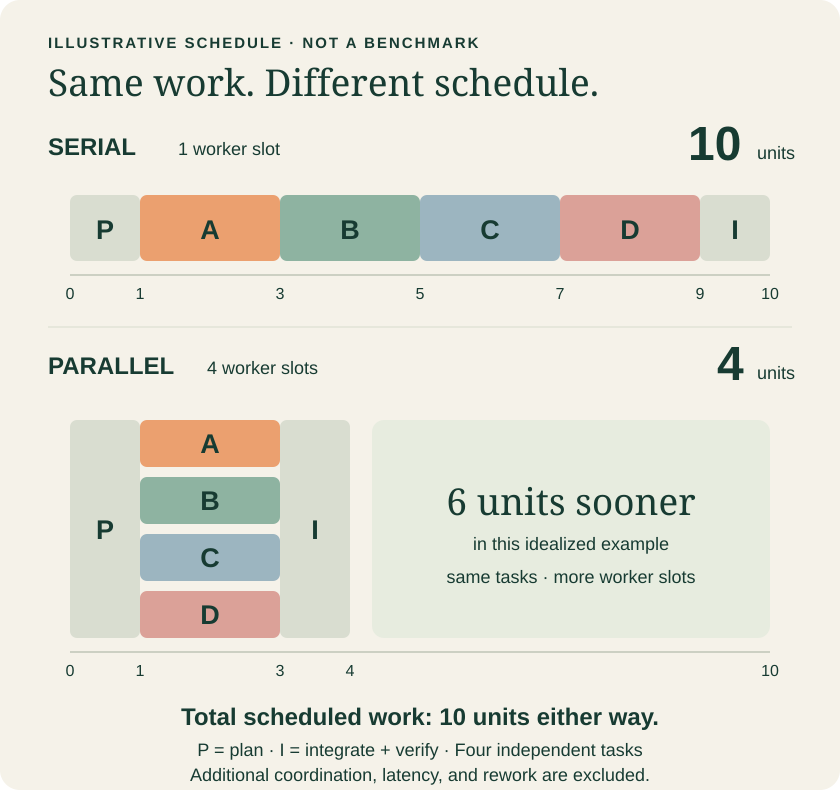

<p align="center">
  
</p>

<h1 align="center">AI-Company</h1>

<p align="center"><strong>You're the boss. Give your AI crew an org chart.</strong></p>
<p align="center">One CTO keeps the big picture. Leads run the teams.<br>Workers build in parallel. You bring the goals and good judgment.</p>

<p align="center"><strong>English</strong> · <a href="README.zh-CN.md">中文</a> · <a href="#clock-in">Clock in</a> · <a href="docs/EXAMPLES.md">See a filled example</a> · <a href="AGENTS.md">AI entrance</a></p>

---

**Workflow 3.1.0** uses one [canonical protocol](WORKFLOW.md), with host-specific guidance in local adapters. The normative specification is maintained in Chinese. The English overview remains a navigation aid. See [layer ownership](docs/LAYERS.md), [engineering checks](docs/ENGINEERING.md), [research](docs/RESEARCH.md), [tool admission](docs/TOOL_ADMISSION.md), and the [change record](docs/CHANGELOG.md).

Version 3.1.0 makes normal-input representative chains a pre-batch check, preserves the first safe failure cause, and keeps requirements and remaining work current. Internal budget adjustments stay within the user's hard limits. Rule-version alignment and new-run loading are verified separately from business delivery and older sessions.

A dozen agent tabs can feel like a small, noisy office. Who owns that file? Did two teams just build the same thing? Why are you delivering everyone's messages?

**Take the boss's chair:** set the goal, make the important calls, and review what ships. Your CTO coordinates the project; leads handle briefs, workers, dependencies, and evidence. Talk to either level without becoming the office mailroom.

AI-Company is a small, readable operating playbook for **large software projects with multiple AI teams**. Bring your coding assistant and its task tools. The repository supplies the roles, communication rules, handoffs, and delivery contract.

## Clock in

**1. Give the handbook its own desk.** Download or clone this repository beside
the project you want to build. Then open **your project** in the coding assistant.

```text
workspace/
  your-project/   <- the app you are building; open this
  AI-Company/     <- the handbook your assistant reads
```

```sh
git clone https://github.com/Timking123/AI-Company.git
```

You can also supply the repository URL if your assistant can read it. The two
locations have different jobs: do not accidentally staff the handbook repository.

**2. Fill three fields, then hand over the brief.** Replace every bracketed field.

```text
Target project: [path to the project I want to build]
Playbook: [path or URL to AI-Company]
Goal: [one concrete outcome I want delivered]

I am the human owner. Apply AI-Company to the Target project.
The Playbook is reference material, not the project to modify.
Read its AGENTS.md and follow the reading order.

First confirm both locations, available tools, project rules, and existing work.
Establish one CTO and reuse existing leads before creating new teams.
Where the host permits it, create the durable, visible tasks this goal needs.
Give each worker one manager and an exclusive write scope.

Let leads resolve direction-local work and report deliveries, decisions needed,
and heavy-operation requests to the CTO. Use phase summaries for routine progress.
Preserve my existing permissions and project quality gates. Return the capability
check, ownership map, and next executable steps. If a required tool is missing,
explain the smallest manual step; do not claim a team is already running.
```

**3. Check the first roll call.** Expect real task identities, named owners,
dependencies, and a next action for each active workstream. Compare the output
with the [filled example](docs/EXAMPLES.md). It shows the shape of a good handoff;
its project, task labels, and results are fictional.

## Meet your company



| You talk to | They take care of |
| --- | --- |
| **CTO** | Project direction, team ownership, shared design, conflicts, duplicate work, and integration order |
| **Team leads** | A complete workstream: planning, worker assignments, review, fixes, and delivery |
| **Workers stay with their lead** | A bounded implementation, investigation, test, or independent review |

Leads coordinate facts and handoffs within their assigned scope. Workers report completion, problems needing higher-level action, or expected scope/budget overruns only to their lead; they fix ordinary errors locally. Leads report direction deliveries and matters needing CTO action. Shared design, ownership, priorities, and acceptance changes go to the CTO. Your explicit decisions do not need a second approval.

## Same work. A shorter critical path.



**The picture is a scheduling example, not a benchmark.** Both schedules contain the same work: 1 planning unit + 4 independent tasks × 2 units + 1 integration unit. Serial execution uses one worker slot; parallel execution uses four. Ideal elapsed time is **10 → 4 units**, while total scheduled work stays **10 units**.

Real coordination, model latency, rate limits, dependencies, and rework can reduce or eliminate the gain. This diagram makes no claim about token savings, API cost, or measured product performance.

> Parallelize independent work. Keep shared decisions and integration coordinated.

## Bring your coding assistant

The workflow is portable Markdown. The [client catalog](docs/COMPATIBILITY.md)
covers 27 entries with official sources, instruction entry points, and limits:

| Find your tools | Clients covered |
| --- | --- |
| Terminal and desktop | Codex, Claude Code, pi, Gemini CLI, OpenCode, Factory Droid, Aider, Amp, Qwen Code |
| IDE and editor | Cursor, Windsurf / Devin Desktop, GitHub Copilot, Cline, Kilo Code, Continue, Augment / Auggie, Kiro, Antigravity, TRAE, Qoder, Junie, Amazon Q Developer, ZCode |
| Managed platforms and SDKs | OpenHands, Devin cloud, Replit Agent |
| Legacy reference | Roo Code, clearly marked with its official shutdown status |

**Documentation coverage is not runtime certification.** Some clients need
independent lead sessions, verified extensions, or human relay. Native subagents
do not automatically provide a persistent, nested company. Check your exact
client, version, and permissions before creating teams.

## Essential boundaries and the full protocol

- Reuse valid authority within its scope and close safely when the user pauses.
- Give each worker one direct manager and each write an explicit owner.
- Protect credentials, original data, existing changes, and original failures.
- Match delivery claims to verified scope and the user's outcome.

The [workflow](WORKFLOW.md) maintains the complete conditions. Section 9 covers resources and time, section 8 covers verification and delivery, and [role guidance](docs/ROLES.md) assigns responsibilities. A bounded task can stay with one capable owner.

## Read the part you need

| File | Reader | What you get |
| --- | --- | --- |
| [AGENTS.md](AGENTS.md) | The assistant entering the repository | Reading order, adoption boundary, and first actions |
| [WORKFLOW.md](WORKFLOW.md) | CTOs and leads | The complete coordination and delivery protocol |
| [Role prompts](docs/ROLES.md) | Whoever creates a role | Ready-to-copy CTO, lead, and worker briefs |
| [Templates](docs/TEMPLATES.md) | Leads and workers | Scope, updates, dependency handoffs, and acceptance evidence |
| [Worked examples](docs/EXAMPLES.md) | Anyone trying the workflow | A filled brief, ownership map, update, handoff, and acceptance record; all fictional |
| [Codex notes](docs/CODEX.md) | Codex users | Capability checks and the distinction between visible tasks and temporary subagents |
| [Client compatibility](docs/COMPATIBILITY.md) | Users of different coding assistants | Reading entry points, nesting limits, and explicit manual alternatives |
| [Validation scenarios](docs/VALIDATION.md) | Maintainers and adopters | Concrete situations to check before trusting a setup |

## What to expect

This is an **experimental, documentation-first workflow**. It does not install an orchestrator, enforce file locks, or provide an agent runtime. Your host must supply the task, communication, filesystem, and version-control capabilities used by the workflow. Models can still misunderstand instructions; use the bootstrap checks and acceptance scenarios.

Use your preferred capable planning model for CTOs and leads, with a supported high-reasoning setting. A quality-first setup can select the current flagship model and the highest supported effort. Record the actual model and setting, respect user choices, and keep application or evaluation model settings separate.

## How was your first day as the boss?

Try one bounded workstream, then [send a short field report](https://github.com/Timking123/AI-Company/issues/new?template=tryout.yml). Tell us which assistant you used, where the flow clicked, or where the office got tangled. A confusing instruction is useful feedback too.

Share a sanitized example, not your private project. Repeated tasks, human interruptions, integration waiting time, and the final acceptance result are useful evidence. The feedback form helps collect the essentials without asking for your whole chat history.

Keep proposed additions small. Prefer a clearer rule or example over another management layer.

[Open an issue](https://github.com/Timking123/AI-Company/issues) · [MIT license](LICENSE) · [Sources and artwork](docs/SOURCES.md) · [Privacy and provenance](docs/PRIVACY.md)
